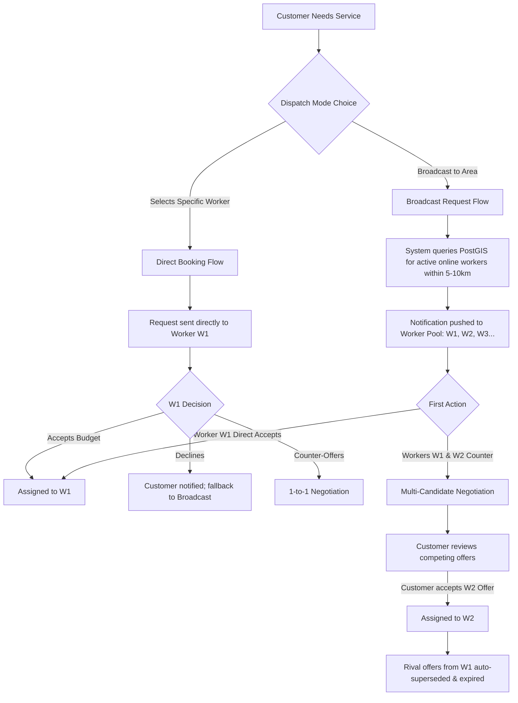
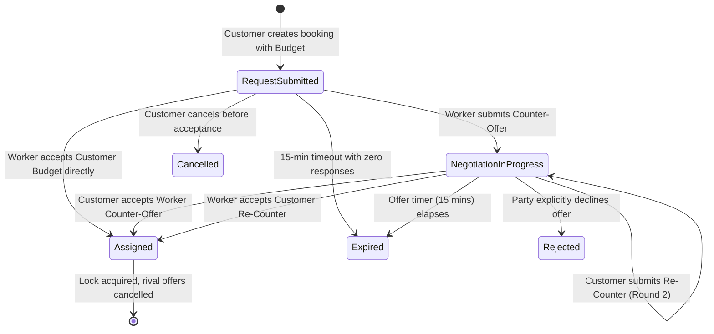

# SERVIQ — Booking & Negotiation Engine Specification

**Document Version:** 1.0.0  
**Target Domain:** Hyperlocal Service Dispatch & Bounded Price Negotiation  

---

## 1. Dispatch Models: Direct vs Broadcast

Serviq supports two distinct booking origination workflows:



### 1.1 Direct Booking Flow
- **Initiation:** Customer browses worker profiles, identifies a specific technician (e.g. "Ramesh Patil"), and clicks "Book now".
- **Targeting:** Exclusive dispatch to `preferred_worker_id`.
- **Response Window:** 15 minutes. If the technician does not respond or declines, the customer is prompted with 1-click fallback to broadcast the request to nearby verified professionals.

### 1.2 Broadcast Request Flow ("Instant Nearby Pool")
- **Initiation:** Customer clicks "Find help" without selecting an individual technician.
- **Geospatial Matching Engine:**
  - Identifies all workers where:
    1. `worker_profiles.is_online = true`
    2. `worker_profiles.verification_status = 'APPROVED'`
    3. `worker_skills` includes requested `service_id`
    4. PostGIS distance `ST_DWithin(worker_location, customer_address, radius_meters) <= radius`
- **Concurrency Policy:** Broadcast is competitive. Multiple workers can view the job card and submit counter-offers. However, the booking can be claimed by **exactly one** worker.

---

## 2. Pricing Hierarchy & Definitions

To prevent billing confusion, every monetary amount in Serviq has a formal definition and stage:

| Term | Stage | Formula / Source | Can it Change? |
| :--- | :--- | :--- | :--- |
| **Estimated Base Price** | Discovery | Platform catalog default or worker's advertised starting fee (e.g., ₹350). | Informational only. |
| **Customer Budget** | Request Creation | Input by customer during booking (e.g., ₹450). Minimum allowed: base inspection fee. | Can be updated during re-counter. |
| **Worker Counter-Offer** | Negotiation | Proposed by worker based on problem complexity (e.g., ₹550). | Valid until counter-offered or expired. |
| **Agreed Price** | Assignment | The mutually confirmed labor/service charge locked at acceptance. | **IMMUTABLE** once accepted. |
| **Extra Approved Materials** | Work Execution | Hardware, replacement pipes, spare parts purchased by worker with receipt. | Requires explicit customer in-app approval OTP. |
| **Platform Convenience Fee**| Checkout | Platform surcharge (e.g., ₹29 or 5% of service). | Fixed platform policy. |
| **Final Payable Amount** | Completion | `Agreed Price + Extra Materials + Platform Fee + Taxes - Promo Discount`. | Final invoice amount. |

---

## 3. Negotiation State Machine & Bounded Rules



### 3.1 Bounded Negotiation Rules
1. **Max Negotiation Rounds:** To prevent protracted haggling, negotiation is capped at **2 rounds per party**:
   - Round 1: Customer Budget -> Worker Counter-Offer.
   - Round 2: Customer Re-Counter -> Worker Final Accept / Decline.
2. **Offer Expiration Timers:**
   - Every offer has an `expires_at` timestamp set strictly to `CURRENT_TIMESTAMP + INTERVAL '15 minutes'`.
   - BullMQ scheduled timer triggers an automatic status change to `EXPIRED` if no action is taken.
3. **Offer Invalidation:**
   - A new counter-offer immediately sets all previous offers from that same worker on that booking to `SUPERSEDED`.
4. **No Silent Overwrites:**
   - If a customer is viewing an offer of ₹400 and the worker submits a new offer of ₹500, the client UI is notified via WebSocket (`offer:updated`), and the customer cannot accept the stale ₹400 offer.

---

## 4. Concurrency Engine & Atomic Lock Acquisition

The most critical race condition in an on-demand marketplace occurs when **two workers attempt to accept or claim the same exclusive booking at the exact same millisecond**.

### 4.1 The Double-Claim Race Condition
- Worker A and Worker B both receive a broadcast request for `SQ-1048`.
- Worker A clicks "Accept Job" at `10:00:00.100`.
- Worker B clicks "Accept Job" at `10:00:00.105`.
- **Naive Implementation Flaw:** If the server simply runs `UPDATE bookings SET assigned_worker_id = ...`, both might receive success or Worker B might overwrite Worker A.

### 4.2 Serviq Atomic Lock Implementation
Serviq prevents race conditions using **PostgreSQL Row-Level Locking (`SELECT FOR UPDATE`)** inside an isolated database transaction:

```sql
-- 1. Begin atomic transaction
BEGIN;

-- 2. Acquire exclusive pessimistic row lock on the target booking
SELECT id, status, assigned_worker_id, initial_customer_budget
FROM bookings 
WHERE id = :booking_id 
FOR UPDATE;

-- 3. Application assertions:
-- IF status NOT IN ('REQUEST_SUBMITTED', 'NEGOTIATION_IN_PROGRESS') THEN
--     ROLLBACK;
--     RAISE EXCEPTION 'BOOKING_ALREADY_CLAIMED' (HTTP 409 Conflict);
-- END IF;

-- 4. Mark the winning worker
UPDATE bookings 
SET 
    assigned_worker_id = :worker_id,
    status = 'ASSIGNED',
    agreed_price = :accepted_price,
    updated_at = CURRENT_TIMESTAMP
WHERE id = :booking_id;

-- 5. Mark accepted offer (if accepting a counter-offer)
UPDATE job_offers 
SET status = 'ACCEPTED' 
WHERE id = :offer_id;

-- 6. Atomically invalidate and supersede all competing pending offers from other workers
UPDATE job_offers 
SET status = 'SUPERSEDED' 
WHERE booking_id = :booking_id AND id != :offer_id AND status = 'PENDING';

-- 7. Record status transition audit
INSERT INTO booking_status_history (booking_id, from_status, to_status, actor_user_id, metadata)
VALUES (:booking_id, 'REQUEST_SUBMITTED', 'ASSIGNED', :actor_user_id, json_build_object('price', :accepted_price));

-- 8. Commit transaction
COMMIT;
```

### 4.3 Post-Commit Event Fanout
Immediately following the commit:
1. **Winning Worker:** Receives WebSocket event `booking:assigned` with customer contact and exact address coordinates.
2. **Losing Workers:** Receive WebSocket event `request:closed` with message: *"This job has been accepted by another nearby professional."* The card vanishes from their incoming requests list.
3. **Customer:** Receives instant push and UI update showing assigned worker details.

---

## 5. End-to-End Booking Lifecycle State Machine

```mermaid
stateDiagram-v2
    [*] --> REQUEST_SUBMITTED: Customer Submits Booking
    
    REQUEST_SUBMITTED --> NEGOTIATION_IN_PROGRESS: Counter-Offer Submitted
    NEGOTIATION_IN_PROGRESS --> ASSIGNED: Offer Accepted (Pessimistic Lock)
    REQUEST_SUBMITTED --> ASSIGNED: Direct Budget Accepted (Pessimistic Lock)
    
    REQUEST_SUBMITTED --> CANCELLED: Customer Cancels (Free)
    NEGOTIATION_IN_PROGRESS --> CANCELLED: Customer Cancels (Free)
    REQUEST_SUBMITTED --> EXPIRED: Zero Responses in 15 mins
    
    ASSIGNED --> ON_THE_WAY: Worker Dispatches
    ASSIGNED --> CANCELLED: Customer Cancels (Possible Fee) / Worker Unassigns
    
    ON_THE_WAY --> ARRIVED: Worker Arrives at Site
    ON_THE_WAY --> CANCELLED: Customer Emergency Cancel (Late Fee Applies)
    
    ARRIVED --> WORK_STARTED: Worker Enters Customer Start OTP
    
    WORK_STARTED --> WORK_COMPLETED: Worker Marks Task Done & Submits Proof
    WORK_STARTED --> DISPUTED: Customer / Worker Escalates Issue
    
    WORK_COMPLETED --> PAID: Customer Pays via Online Gateway or Cash
    PAID --> CONFIRMED_COMPLETED: Customer Confirms or 24hr Auto-Close
    
    CONFIRMED_COMPLETED --> [*]: Booking Archived; Review Eligible
    CANCELLED --> [*]: Terminal State
    DISPUTED --> CONFIRMED_COMPLETED: Support Resolves Dispute
```



### 5.1 State Gate Matrix & Permissions

| Transition | From State | To State | Authorized Actor | Pre-Conditions & Constraints |
| :--- | :--- | :--- | :--- | :--- |
| **`T01`** | `null` | `REQUEST_SUBMITTED` | Customer | Valid service address, budget >= base fee. |
| **`T02`** | `REQUEST_SUBMITTED` | `NEGOTIATION_IN_PROGRESS` | Worker / Customer | Booking is unassigned; valid counter price. |
| **`T03`** | `REQUEST_SUBMITTED` or `NEGOTIATION` | `ASSIGNED` | Winning Worker or Customer | DB row lock acquired; price locked. |
| **`T04`** | `ASSIGNED` | `ON_THE_WAY` | Assigned Worker | Worker is marked active on shift. |
| **`T05`** | `ON_THE_WAY` | `ARRIVED` | Assigned Worker | Proximity check (worker within 300m of customer address). |
| **`T06`** | `ARRIVED` | `WORK_STARTED` | Assigned Worker | **Requires Customer Start OTP** entered by worker. |
| **`T07`** | `WORK_STARTED` | `WORK_COMPLETED` | Assigned Worker | Task completed; optional completion photo uploaded. |
| **`T08`** | `WORK_COMPLETED` | `PAID` | Customer / Gateway Webhook | Payment captured or Cash on Delivery marked verified. |
| **`T09`** | `PAID` | `CONFIRMED_COMPLETED` | Customer or System Cron | Customer confirms satisfaction or 24-hr timer expires. |
| **`T10`** | Any prior to `WORK_STARTED` | `CANCELLED` | Customer, Worker, or Admin | Cancellation reason recorded; fee rules evaluated. |
| **`T11`** | `WORK_STARTED` or `WORK_COMPLETED` | `DISPUTED` | Customer or Worker | Dispute notes submitted; funds held in escrow. |
