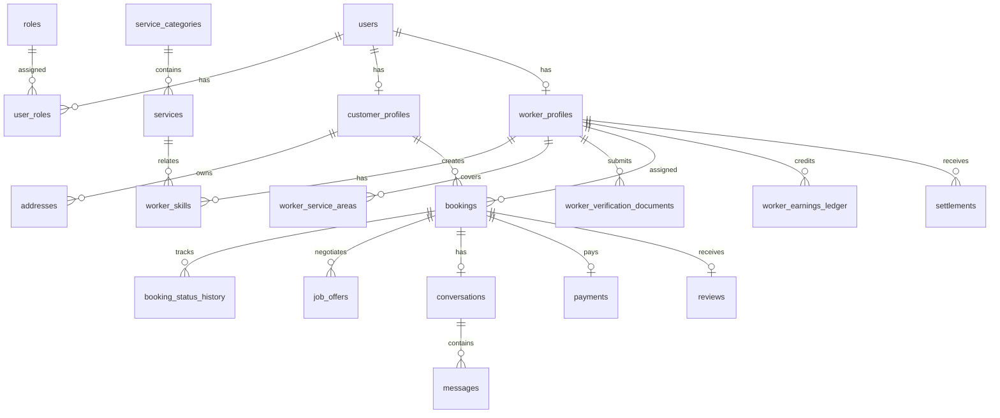

# SERVIQ — Database Schema Specification

**Document Version:** 1.0.0  
**Database Engine:** PostgreSQL 16+ with PostGIS Extension  
**Naming Conventions:** `snake_case` tables and columns, plural table names, UUID v7 or ULID/CUID2 primary keys for distributed chronological indexing, `TIMESTAMPTZ` for all temporal fields.  
**Monetary Representation:** `INTEGER` representing the smallest currency unit (e.g., Indian Paise: ₹350.00 = `35000`) or `DECIMAL(10, 2)` to eliminate floating-point precision loss. Here we specify `DECIMAL(10, 2)` with currency code column for universal clarity.

---

## 1. Schema Entity-Relationship (ER) Overview

---

## 2. Table Specifications

### 2.1 Identity, Authentication & Roles

#### Table: `users`
- **Purpose:** Core authentication entity representing every person on the platform.
- **Columns:**
  - `id` (UUID, Primary Key, default `gen_random_uuid()`)
  - `phone_number` (VARCHAR(20), Unique, Not Null) — E.164 format (e.g., `+919876543210`)
  - `email` (VARCHAR(255), Unique, Nullable) — Optional verified email
  - `password_hash` (VARCHAR(255), Nullable) — Argon2id hash (null for OTP-only users)
  - `is_phone_verified` (BOOLEAN, Not Null, default `false`)
  - `is_email_verified` (BOOLEAN, Not Null, default `false`)
  - `status` (VARCHAR(30), Not Null, default `'ACTIVE'`) — `ACTIVE`, `SUSPENDED`, `DEACTIVATED`, `PENDING_REVIEW`
  - `last_login_at` (TIMESTAMPTZ, Nullable)
  - `created_at` (TIMESTAMPTZ, Not Null, default `CURRENT_TIMESTAMP`)
  - `updated_at` (TIMESTAMPTZ, Not Null, default `CURRENT_TIMESTAMP`)
- **Indexes:** `idx_users_phone` (`phone_number`), `idx_users_status` (`status`).
- **Validation:** Check constraint on status enum values; regex on phone number.

#### Table: `roles` & `user_roles`
- **Purpose:** RBAC mapping supporting dual-role accounts (a user can be both a Customer and a Worker under the same auth credentials).
- **Columns (`roles`):**
  - `id` (VARCHAR(30), Primary Key) — `'CUSTOMER'`, `'WORKER'`, `'ADMIN'`, `'SUPPORT'`
  - `description` (TEXT, Not Null)
- **Columns (`user_roles`):**
  - `user_id` (UUID, Foreign Key -> `users.id` ON DELETE CASCADE)
  - `role_id` (VARCHAR(30), Foreign Key -> `roles.id` ON DELETE CASCADE)
  - `assigned_at` (TIMESTAMPTZ, Not Null, default `CURRENT_TIMESTAMP`)
  - *Primary Key:* `(user_id, role_id)`

---

### 2.2 Profiles & Verification

#### Table: `customer_profiles`
- **Purpose:** Customer-specific personal data.
- **Columns:**
  - `id` (UUID, Primary Key, Foreign Key -> `users.id` ON DELETE CASCADE)
  - `first_name` (VARCHAR(100), Not Null)
  - `last_name` (VARCHAR(100), Not Null)
  - `avatar_url` (TEXT, Nullable)
  - `emergency_contact_phone` (VARCHAR(20), Nullable)
  - `created_at` (TIMESTAMPTZ, Not Null, default `CURRENT_TIMESTAMP`)
  - `updated_at` (TIMESTAMPTZ, Not Null, default `CURRENT_TIMESTAMP`)

#### Table: `worker_profiles`
- **Purpose:** Professional trade details, ratings, verification badges, and real-time status.
- **Columns:**
  - `id` (UUID, Primary Key, Foreign Key -> `users.id` ON DELETE CASCADE)
  - `first_name` (VARCHAR(100), Not Null)
  - `last_name` (VARCHAR(100), Not Null)
  - `avatar_url` (TEXT, Nullable)
  - `bio` (TEXT, Nullable) — Short summary / tagline
  - `experience_years` (NUMERIC(3, 1), Not Null, default `1.0`)
  - `is_verified` (BOOLEAN, Not Null, default `false`) — Only set to true by Admin approval
  - `verification_status` (VARCHAR(30), Not Null, default `'UNVERIFIED'`) — `UNVERIFIED`, `PENDING_REVIEW`, `APPROVED`, `REJECTED`
  - `is_online` (BOOLEAN, Not Null, default `false`) — Live availability toggle
  - `base_visiting_fee` (DECIMAL(10, 2), Not Null, default `250.00`)
  - `completed_jobs_count` (INTEGER, Not Null, default `0`)
  - `average_rating` (NUMERIC(3, 2), Not Null, default `0.00`)
  - `total_reviews_count` (INTEGER, Not Null, default `0`)
  - `avg_response_time_seconds` (INTEGER, Not Null, default `600`) — Rolling response average
  - `created_at` (TIMESTAMPTZ, Not Null, default `CURRENT_TIMESTAMP`)
  - `updated_at` (TIMESTAMPTZ, Not Null, default `CURRENT_TIMESTAMP`)
- **Indexes:** `idx_worker_discovery` (`is_online`, `is_verified`, `verification_status`), `idx_worker_rating` (`average_rating` DESC).

#### Table: `worker_verification_documents`
- **Purpose:** Stores sensitive identity and trade credentials uploaded for compliance.
- **Columns:**
  - `id` (UUID, Primary Key, default `gen_random_uuid()`)
  - `worker_id` (UUID, Foreign Key -> `worker_profiles.id` ON DELETE CASCADE)
  - `document_type` (VARCHAR(50), Not Null) — `AADHAAR_FRONT`, `AADHAAR_BACK`, `DRIVING_LICENSE`, `TRADE_CERTIFICATE`
  - `document_url` (TEXT, Not Null) — Private S3 storage path
  - `status` (VARCHAR(30), Not Null, default `'SUBMITTED'`) — `SUBMITTED`, `VERIFIED`, `REJECTED`
  - `reviewer_notes` (TEXT, Nullable)
  - `reviewed_by` (UUID, Foreign Key -> `users.id`, Nullable)
  - `reviewed_at` (TIMESTAMPTZ, Nullable)
  - `created_at` (TIMESTAMPTZ, Not Null, default `CURRENT_TIMESTAMP`)

---

### 2.3 Locations & Geometries

#### Table: `addresses`
- **Purpose:** Customer saved physical locations.
- **Columns:**
  - `id` (UUID, Primary Key, default `gen_random_uuid()`)
  - `customer_id` (UUID, Foreign Key -> `customer_profiles.id` ON DELETE CASCADE)
  - `address_label` (VARCHAR(50), Not Null) — e.g., `'Home'`, `'Office'`, `'Rental'`
  - `address_line_1` (VARCHAR(255), Not Null) — Flat, Door No, Building
  - `address_line_2` (VARCHAR(255), Nullable) — Street, Landmark
  - `locality` (VARCHAR(100), Not Null) — e.g., `'Bhayandar West'`
  - `city` (VARCHAR(100), Not Null) — e.g., `'Mumbai'`
  - `postal_code` (VARCHAR(20), Not Null)
  - `location` (GEOMETRY(Point, 4326), Not Null) — PostGIS Longitude/Latitude point
  - `is_default` (BOOLEAN, Not Null, default `false`)
  - `created_at` (TIMESTAMPTZ, Not Null, default `CURRENT_TIMESTAMP`)
  - `updated_at` (TIMESTAMPTZ, Not Null, default `CURRENT_TIMESTAMP`)
- **Indexes:** `idx_addresses_geo` USING GIST (`location`), `idx_addresses_customer` (`customer_id`).
- **Constraints:** Partial unique index: `CREATE UNIQUE INDEX uniq_customer_default_address ON addresses (customer_id) WHERE is_default = true;`

#### Table: `worker_service_areas`
- **Purpose:** Defines the geographical zones and radius where a worker operates.
- **Columns:**
  - `id` (UUID, Primary Key, default `gen_random_uuid()`)
  - `worker_id` (UUID, Foreign Key -> `worker_profiles.id` ON DELETE CASCADE)
  - `center_point` (GEOMETRY(Point, 4326), Not Null)
  - `radius_km` (NUMERIC(4, 1), Not Null, default `10.0`)
  - `created_at` (TIMESTAMPTZ, Not Null, default `CURRENT_TIMESTAMP`)
- **Indexes:** `idx_service_area_geo` USING GIST (`center_point`).

---

### 2.4 Services & Taxonomy

#### Table: `service_categories`
- **Purpose:** Top-level categories (e.g., Plumbing, Electrical, Cleaning).
- **Columns:**
  - `id` (UUID, Primary Key, default `gen_random_uuid()`)
  - `name` (VARCHAR(100), Unique, Not Null)
  - `slug` (VARCHAR(100), Unique, Not Null)
  - `icon_key` (VARCHAR(50), Not Null) — Lucide icon identifier (e.g., `'Wrench'`)
  - `display_order` (INTEGER, Not Null, default `0`)
  - `is_active` (BOOLEAN, Not Null, default `true`)
  - `created_at` (TIMESTAMPTZ, Not Null, default `CURRENT_TIMESTAMP`)

#### Table: `services`
- **Purpose:** Sub-services under categories (e.g., Tap Repair, Water Heater Fix).
- **Columns:**
  - `id` (UUID, Primary Key, default `gen_random_uuid()`)
  - `category_id` (UUID, Foreign Key -> `service_categories.id` ON DELETE RESTRICT)
  - `name` (VARCHAR(150), Not Null)
  - `slug` (VARCHAR(150), Unique, Not Null)
  - `description` (TEXT, Nullable)
  - `typical_price_min` (DECIMAL(10, 2), Not Null)
  - `typical_price_max` (DECIMAL(10, 2), Not Null)
  - `is_active` (BOOLEAN, Not Null, default `true`)
  - `created_at` (TIMESTAMPTZ, Not Null, default `CURRENT_TIMESTAMP`)

#### Table: `worker_skills`
- **Purpose:** Mapping which specific services each worker provides.
- **Columns:**
  - `worker_id` (UUID, Foreign Key -> `worker_profiles.id` ON DELETE CASCADE)
  - `service_id` (UUID, Foreign Key -> `services.id` ON DELETE RESTRICT)
  - `experience_months` (INTEGER, Not Null, default `12`)
  - *Primary Key:* `(worker_id, service_id)`

---

### 2.5 Bookings, Negotiations & Offers

#### Table: `bookings`
- **Purpose:** Central entity for every service engagement.
- **Columns:**
  - `id` (UUID, Primary Key, default `gen_random_uuid()`)
  - `booking_code` (VARCHAR(20), Unique, Not Null) — Human-readable code e.g. `SQ-1048`
  - `customer_id` (UUID, Foreign Key -> `customer_profiles.id` ON DELETE RESTRICT)
  - `assigned_worker_id` (UUID, Foreign Key -> `worker_profiles.id`, Nullable)
  - `service_id` (UUID, Foreign Key -> `services.id` ON DELETE RESTRICT)
  - `address_id` (UUID, Foreign Key -> `addresses.id` ON DELETE RESTRICT)
  - `service_location` (GEOMETRY(Point, 4326), Not Null) — Cached snapshot of coordinates
  - `dispatch_type` (VARCHAR(20), Not Null) — `'DIRECT'`, `'BROADCAST'`
  - `schedule_type` (VARCHAR(20), Not Null) — `'IMMEDIATE'`, `'SCHEDULED'`
  - `scheduled_start_time` (TIMESTAMPTZ, Nullable)
  - `scheduled_end_time` (TIMESTAMPTZ, Nullable)
  - `issue_description` (TEXT, Not Null)
  - `status` (VARCHAR(40), Not Null, default `'REQUEST_SUBMITTED'`)
    - *Enum Values:* `REQUEST_SUBMITTED`, `NEGOTIATION_IN_PROGRESS`, `ASSIGNED`, `ON_THE_WAY`, `ARRIVED`, `WORK_STARTED`, `WORK_COMPLETED`, `PAID`, `CONFIRMED_COMPLETED`, `CANCELLED`, `DISPUTED`
  - `initial_customer_budget` (DECIMAL(10, 2), Not Null)
  - `agreed_price` (DECIMAL(10, 2), Nullable) — Locked once worker accepts or counter accepted
  - `final_payable_amount` (DECIMAL(10, 2), Nullable) — Agreed price + extra approved parts/costs
  - `start_verification_otp` (VARCHAR(6), Nullable) — 4-6 digit safety code given by customer to worker to begin work
  - `completion_verification_otp` (VARCHAR(6), Nullable)
  - `cancellation_reason` (TEXT, Nullable)
  - `cancelled_by_user_id` (UUID, Foreign Key -> `users.id`, Nullable)
  - `created_at` (TIMESTAMPTZ, Not Null, default `CURRENT_TIMESTAMP`)
  - `updated_at` (TIMESTAMPTZ, Not Null, default `CURRENT_TIMESTAMP`)
- **Indexes:** `idx_bookings_customer` (`customer_id`, `created_at` DESC), `idx_bookings_worker` (`assigned_worker_id`, `created_at` DESC), `idx_bookings_status` (`status`).

#### Table: `job_offers`
- **Purpose:** Full audit log and state tracker for every price quote, counter-offer, and negotiation step.
- **Columns:**
  - `id` (UUID, Primary Key, default `gen_random_uuid()`)
  - `booking_id` (UUID, Foreign Key -> `bookings.id` ON DELETE CASCADE)
  - `worker_id` (UUID, Foreign Key -> `worker_profiles.id` ON DELETE CASCADE)
  - `offered_by_role` (VARCHAR(20), Not Null) — `'WORKER'`, `'CUSTOMER'`
  - `offered_price` (DECIMAL(10, 2), Not Null)
  - `notes` (TEXT, Nullable)
  - `status` (VARCHAR(30), Not Null, default `'PENDING'`) — `PENDING`, `ACCEPTED`, `REJECTED`, `EXPIRED`, `SUPERSEDED`, `CANCELLED`
  - `expires_at` (TIMESTAMPTZ, Not Null) — Strict server-side expiration deadline (e.g. 15 mins)
  - `created_at` (TIMESTAMPTZ, Not Null, default `CURRENT_TIMESTAMP`)
- **Indexes:** `idx_job_offers_booking` (`booking_id`, `status`), `idx_job_offers_worker` (`worker_id`, `status`).

#### Table: `booking_status_history`
- **Purpose:** Immutable append-only audit trail recording every state change and initiating user.
- **Columns:**
  - `id` (BIGSERIAL, Primary Key)
  - `booking_id` (UUID, Foreign Key -> `bookings.id` ON DELETE CASCADE)
  - `from_status` (VARCHAR(40), Nullable)
  - `to_status` (VARCHAR(40), Not Null)
  - `actor_user_id` (UUID, Foreign Key -> `users.id`, Nullable)
  - `metadata` (JSONB, Nullable) — e.g. GPS coordinates, cancellation notes
  - `created_at` (TIMESTAMPTZ, Not Null, default `CURRENT_TIMESTAMP`)
- **Indexes:** `idx_history_booking` (`booking_id`, `created_at` ASC).

---

### 2.6 Messaging & Notifications

#### Table: `conversations`
- **Purpose:** 1-to-1 chat channel tied directly to a booking engagement.
- **Columns:**
  - `id` (UUID, Primary Key, default `gen_random_uuid()`)
  - `booking_id` (UUID, Unique, Foreign Key -> `bookings.id` ON DELETE CASCADE)
  - `customer_id` (UUID, Foreign Key -> `customer_profiles.id` ON DELETE RESTRICT)
  - `worker_id` (UUID, Foreign Key -> `worker_profiles.id` ON DELETE RESTRICT)
  - `last_message_at` (TIMESTAMPTZ, Nullable)
  - `created_at` (TIMESTAMPTZ, Not Null, default `CURRENT_TIMESTAMP`)

#### Table: `messages`
- **Purpose:** Individual chat entries.
- **Columns:**
  - `id` (UUID, Primary Key, default `gen_random_uuid()`)
  - `conversation_id` (UUID, Foreign Key -> `conversations.id` ON DELETE CASCADE)
  - `sender_id` (UUID, Foreign Key -> `users.id` ON DELETE RESTRICT)
  - `body` (TEXT, Not Null)
  - `attachment_url` (TEXT, Nullable)
  - `attachment_type` (VARCHAR(30), Nullable) — `'IMAGE'`, `'DOCUMENT'`
  - `is_read` (BOOLEAN, Not Null, default `false`)
  - `read_at` (TIMESTAMPTZ, Nullable)
  - `created_at` (TIMESTAMPTZ, Not Null, default `CURRENT_TIMESTAMP`)
- **Indexes:** `idx_messages_conversation` (`conversation_id`, `created_at` ASC).

#### Table: `notifications`
- **Purpose:** In-app inbox alerts.
- **Columns:**
  - `id` (UUID, Primary Key, default `gen_random_uuid()`)
  - `recipient_user_id` (UUID, Foreign Key -> `users.id` ON DELETE CASCADE)
  - `title` (VARCHAR(150), Not Null)
  - `body` (TEXT, Not Null)
  - `event_type` (VARCHAR(50), Not Null) — e.g. `'NEW_REQUEST'`, `'COUNTER_OFFER'`, `'BOOKING_ASSIGNED'`
  - `reference_id` (UUID, Nullable) — e.g. `booking_id`
  - `is_read` (BOOLEAN, Not Null, default `false`)
  - `created_at` (TIMESTAMPTZ, Not Null, default `CURRENT_TIMESTAMP`)
- **Indexes:** `idx_notifications_user` (`recipient_user_id`, `is_read`, `created_at` DESC).

---

### 2.7 Financials, Payments, Earnings & Ledger

#### Table: `payments`
- **Purpose:** Customer transaction receipts from payment gateway or cash collection.
- **Columns:**
  - `id` (UUID, Primary Key, default `gen_random_uuid()`)
  - `booking_id` (UUID, Foreign Key -> `bookings.id` ON DELETE RESTRICT)
  - `customer_id` (UUID, Foreign Key -> `customer_profiles.id` ON DELETE RESTRICT)
  - `gateway_provider` (VARCHAR(30), Not Null) — `'RAZORPAY'`, `'STRIPE'`, `'CASH'`
  - `gateway_payment_id` (VARCHAR(150), Unique, Nullable)
  - `gateway_order_id` (VARCHAR(150), Nullable)
  - `amount` (DECIMAL(10, 2), Not Null)
  - `currency` (VARCHAR(3), Not Null, default `'INR'`)
  - `status` (VARCHAR(30), Not Null) — `'PENDING'`, `'CAPTURED'`, `'FAILED'`, `'REFUNDED'`
  - `captured_at` (TIMESTAMPTZ, Nullable)
  - `created_at` (TIMESTAMPTZ, Not Null, default `CURRENT_TIMESTAMP`)

#### Table: `worker_earnings_ledger`
- **Purpose:** Double-entry ledger recording all credits (service payouts) and debits (platform commissions, tax withholding, cash collections).
- **Columns:**
  - `id` (BIGSERIAL, Primary Key)
  - `worker_id` (UUID, Foreign Key -> `worker_profiles.id` ON DELETE RESTRICT)
  - `booking_id` (UUID, Foreign Key -> `bookings.id`, Nullable)
  - `entry_type` (VARCHAR(30), Not Null) — `'JOB_EARNING'`, `'PLATFORM_COMMISSION'`, `'TAX_TDS'`, `'SETTLEMENT_PAYOUT'`, `'ADJUSTMENT'`
  - `gross_amount` (DECIMAL(10, 2), Not Null)
  - `commission_amount` (DECIMAL(10, 2), Not Null, default `0.00`)
  - `net_amount` (DECIMAL(10, 2), Not Null)
  - `is_settled` (BOOLEAN, Not Null, default `false`)
  - `settlement_id` (UUID, Nullable)
  - `created_at` (TIMESTAMPTZ, Not Null, default `CURRENT_TIMESTAMP`)
- **Indexes:** `idx_ledger_worker` (`worker_id`, `is_settled`, `created_at` DESC).

#### Table: `settlements`
- **Purpose:** Bank payout records transferring cleared funds to worker accounts.
- **Columns:**
  - `id` (UUID, Primary Key, default `gen_random_uuid()`)
  - `worker_id` (UUID, Foreign Key -> `worker_profiles.id` ON DELETE RESTRICT)
  - `amount` (DECIMAL(10, 2), Not Null)
  - `payout_method` (VARCHAR(30), Not Null, default `'BANK_TRANSFER'`) — `'BANK_TRANSFER'`, `'UPI'`
  - `payout_reference` (VARCHAR(150), Unique, Nullable) — Bank UTR or gateway transfer ID
  - `status` (VARCHAR(30), Not Null, default `'PENDING'`) — `'PENDING'`, `'PROCESSING'`, `'SUCCESS'`, `'FAILED'`
  - `settled_at` (TIMESTAMPTZ, Nullable)
  - `created_at` (TIMESTAMPTZ, Not Null, default `CURRENT_TIMESTAMP`)

---

### 2.8 Reviews & Reputation

#### Table: `reviews`
- **Purpose:** Customer reviews tied strictly to verified completed bookings.
- **Columns:**
  - `id` (UUID, Primary Key, default `gen_random_uuid()`)
  - `booking_id` (UUID, Unique, Foreign Key -> `bookings.id` ON DELETE RESTRICT)
  - `customer_id` (UUID, Foreign Key -> `customer_profiles.id` ON DELETE RESTRICT)
  - `worker_id` (UUID, Foreign Key -> `worker_profiles.id` ON DELETE RESTRICT)
  - `rating` (SMALLINT, Not Null) — CHECK (`rating >= 1 AND rating <= 5`)
  - `comment` (TEXT, Nullable)
  - `quality_tags` (TEXT[], Nullable) — e.g. `['Punctual', 'Clean Work', 'Polite']`
  - `worker_reply` (TEXT, Nullable)
  - `worker_replied_at` (TIMESTAMPTZ, Nullable)
  - `is_moderated` (BOOLEAN, Not Null, default `false`)
  - `created_at` (TIMESTAMPTZ, Not Null, default `CURRENT_TIMESTAMP`)
  - `updated_at` (TIMESTAMPTZ, Not Null, default `CURRENT_TIMESTAMP`)
- **Indexes:** `idx_reviews_worker` (`worker_id`, `rating`), `idx_reviews_customer` (`customer_id`).

---

## 3. Data Retention & Archival Policies

1. **Permanent & Immutable Data (Retention: 7+ Years for Statutory & Tax Compliance):**
   - `users`, `payments`, `worker_earnings_ledger`, `settlements`, `booking_status_history`.
   - Never hard-deleted; customer deactivation executes an anonymization pass (scrubbing names, phone numbers, and addresses) while keeping financial ledgers structurally intact.
2. **Operational Data (Retention: Active Lifecycle + 2 Years):**
   - `bookings`, `reviews`, `worker_verification_documents` (active accounts).
3. **Expiring & Ephemeral Data (Auto-Pruned after 30 to 90 Days):**
   - Expired `job_offers` that were never accepted: pruned or archived to cold storage after 90 days.
   - Read in-app `notifications`: auto-deleted after 60 days.
   - Verification OTPs (`start_verification_otp`): nullified immediately upon verification completion.
