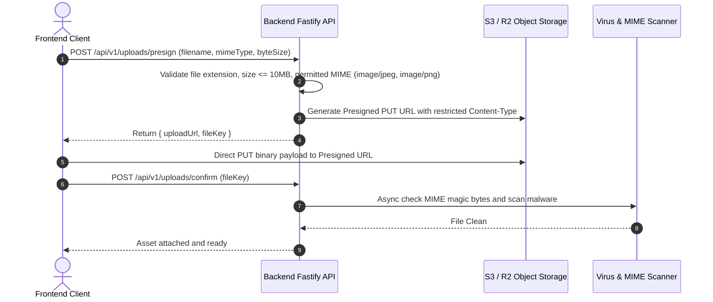

# SERVIQ — Security & Permissions Architecture

**Document Version:** 1.0.0  
**Target Platform:** Hyperlocal Blue-Collar Services Marketplace  
**Security Baseline:** OWASP Top 10, Zero-Trust Backend Architecture, PCI-DSS Level 4 Integration  

---

## 1. Authentication & Session Management

### 1.1 Password & Credential Hashing
- **Algorithm:** **Argon2id** (OWASP recommended password hashing algorithm).
  - Parameters: Memory cost = 64 MB, Time cost = 3 iterations, Parallelism = 4 threads.
  - Plaintext passwords or unhashed OTPs are **never stored** in the database or logged in application traces.

### 1.2 Dual-Token Session Architecture
- **Access Tokens:**
  - Standard JSON Web Token (JWT) signed with `RS256` (Asymmetric Private/Public key pair).
  - Lifespan: **15 minutes** (short-lived).
  - Payload: `{ sub: user_id, roles: ['CUSTOMER', 'WORKER'], exp: ... }`.
  - Stored in-memory in the React frontend (or secure cookie).
- **Refresh Tokens:**
  - Cryptographically secure 256-bit random string (`crypto.randomBytes(32).toString('hex')`).
  - Stored strictly in an **HttpOnly, Secure, SameSite=Strict** cookie.
  - Lifespan: **30 days**.
  - Persisted in Redis / PostgreSQL with user association and family tracking.
  - **Automatic Token Rotation:** Every refresh token exchange invalidates the old token and issues a new one. If an invalidated refresh token is reused, the entire token family is revoked immediately (detecting token theft).

---

## 2. Authorization & Access Control (RBAC & ABAC)

### 2.1 Role-Based Access Control (RBAC)
User permissions are partitioned across four explicit roles:
1. `CUSTOMER`: Access to booking creation, saved addresses, discovery, personal chat, customer reviews.
2. `WORKER`: Access to job request feeds, counter-offers, active job execution, earnings dashboard, payouts.
3. `SUPPORT`: Read-only access to customer/worker bookings, chat transcripts (for dispute arbitration), review moderation.
4. `ADMIN`: Full platform access (KYC verification approval, worker suspension, fee parameter configuration).

### 2.2 Object-Level Ownership Checks (ABAC)
**Rule: Never trust an entity ID supplied by the client without verifying ownership.**

Every endpoint inspecting or modifying sensitive data enforces ownership verification in service layer guards:
- **Bookings:**
  ```typescript
  // Service-level ownership assertion
  async function assertBookingAccess(bookingId: string, currentUser: AuthUser) {
    const booking = await bookingRepo.findById(bookingId);
    if (!booking) throw new NotFoundError('Booking not found');
    
    const isCustomer = booking.customerId === currentUser.id;
    const isAssignedWorker = booking.assignedWorkerId === currentUser.id;
    const isAdmin = currentUser.roles.includes('ADMIN');
    
    if (!isCustomer && !isAssignedWorker && !isAdmin) {
      throw new ForbiddenError('You do not have permission to access this booking.');
    }
    return booking;
  }
  ```
- **Conversations & Messages:** A user can only fetch messages or emit socket events if their `user_id` matches `customer_id` or `worker_id` for that conversation.
- **Addresses:** Customers can only query, update, or delete addresses where `customer_id === current_user.id`.
- **Earnings & Payouts:** Workers can only access ledger entries where `worker_id === current_user.id`.

### 2.3 Supabase Row Level Security (RLS) Policies (When Deployed on Supabase)
If Supabase PostgreSQL is utilized as the database layer, the following foundational RLS policies are enforced:

```sql
-- Enable RLS on core tables
ALTER TABLE customer_profiles ENABLE ROW LEVEL SECURITY;
ALTER TABLE worker_profiles ENABLE ROW LEVEL SECURITY;
ALTER TABLE addresses ENABLE ROW LEVEL SECURITY;
ALTER TABLE bookings ENABLE ROW LEVEL SECURITY;
ALTER TABLE messages ENABLE ROW LEVEL SECURITY;
ALTER TABLE worker_earnings_ledger ENABLE ROW LEVEL SECURITY;

-- 1. Customer Profiles: Users can read and update their own profile
CREATE POLICY customer_profile_owner ON customer_profiles
  FOR ALL USING (auth.uid() = id);

-- 2. Addresses: Customers can only manage their own addresses
CREATE POLICY address_owner_access ON addresses
  FOR ALL USING (auth.uid() = customer_id);

-- 3. Bookings: Only involved customer, assigned worker, or admin can read
CREATE POLICY booking_participant_access ON bookings
  FOR SELECT USING (
    auth.uid() = customer_id 
    OR auth.uid() = assigned_worker_id
    OR EXISTS (SELECT 1 FROM user_roles WHERE user_id = auth.uid() AND role_id = 'ADMIN')
  );

-- 4. Messages: Only conversation participants can view messages
CREATE POLICY message_participant_read ON messages
  FOR SELECT USING (
    EXISTS (
      SELECT 1 FROM conversations c
      WHERE c.id = messages.conversation_id
      AND (c.customer_id = auth.uid() OR c.worker_id = auth.uid())
    )
  );

-- 5. Earnings Ledger: Workers can only view their own ledger rows
CREATE POLICY ledger_worker_read ON worker_earnings_ledger
  FOR SELECT USING (auth.uid() = worker_id);
```

---

## 3. Input Validation & Data Sanitization

### 3.1 Strict Schema Enforcement (Zod)
- Every incoming HTTP request (body, query, headers, route params) is validated against a compiled Zod schema before hitting controller handlers.
- Excess or unknown fields in request bodies are automatically stripped.
- Price inputs must be strictly positive numeric values; strings masquerading as numbers are rejected.

### 3.2 SQL Injection & XSS Defenses
- All database queries utilize **parameterized prepared statements** via Drizzle ORM or PostgreSQL native drivers. Raw concatenated SQL strings are strictly prohibited.
- Text inputs rendered in the frontend (such as `issue_description` or chat messages) are sanitized and stripped of executable `<script>`, `<iframe>`, or HTML tags.

---

## 4. Rate Limiting & Abuse Prevention

Rate limiting is enforced at the Fastify gateway layer using a **Redis Token Bucket** algorithm (`@fastify/rate-limit`):

| Scope / Endpoint | Rate Limit Window | Max Requests | Action on Exceeded |
| :--- | :--- | :--- | :--- |
| **`/api/v1/auth/request-otp`** | 10 Minutes | 3 per IP & Phone | 429 Too Many Requests; lockout |
| **`/api/v1/auth/verify-otp`** | 5 Minutes | 5 attempts | 429 Too Many Requests; invalidates OTP |
| **`/api/v1/workers/search`** | 1 Minute | 60 requests | 429 Throttle |
| **`/api/v1/bookings` (Create)** | 10 Minutes | 5 bookings | Prevents spam request floods |
| **`/api/v1/bookings/:id/offers`**| 1 Minute | 10 offers | Prevents automated price spamming |
| **Global API Baseline** | 1 Minute | 120 requests per IP | Standard DDoS mitigation |

---

## 5. Secure File Upload Pipeline

To prevent malicious file execution (e.g. uploading web shells disguised as images), Serviq enforces a **Presigned Upload Pipeline**:



### Storage Bucket Permissions:
1. `public-assets`: Public read; no sensitive information.
2. `booking-media`: Private; accessible only via short-lived (15 min) presigned GET URLs generated for verified booking participants.
3. `kyc-documents`: Highly restricted private bucket; server-side encrypted with AWS KMS (`aws:kms`); accessible strictly by authorized Admin roles.

---

## 6. Payment Security & Webhook Idempotency

### 6.1 PCI-DSS Compliance
- The Serviq backend **never ingests, transmits, or stores credit/debit card numbers, CVVs, or bank net-banking passwords**.
- Card entry occurs strictly inside hosted gateway SDKs (Razorpay / Stripe Elements / UPI Intent).
- The backend stores only non-sensitive tokens: `gateway_payment_id`, `gateway_order_id`, and last 4 card digits for receipt display.

### 6.2 Cryptographic Webhook Signature Verification
- Webhooks from payment gateways are validated using the provider's HMAC SHA-256 signature against a secret key stored in environment variables.
- Requests failing signature verification are rejected with HTTP 400 immediately.

### 6.3 Idempotency Enforcement (`Idempotency-Key`)
- To prevent duplicate booking charges caused by network timeouts or repeated button clicks:
  - Critical endpoints (`POST /api/v1/bookings`, `POST /api/v1/payments/charge`) accept an `Idempotency-Key: <UUID>` header.
  - The server stores the key in Redis with a 24-hour TTL upon execution start.
  - If a subsequent request arrives with the same key while processing, it waits; if already completed, it returns the cached response without re-executing payment or booking creation.

---

## 7. Audit Logging & Account Suspension Protocol

### 7.1 Immutable Audit Logs
Every administrative and financial event is recorded in the `audit_logs` table:
- Attributes: `actor_id`, `action` (e.g. `WORKER_KYC_APPROVED`, `WORKER_SUSPENDED`, `DISPUTE_REFUND_ISSUED`), `target_entity_type`, `target_entity_id`, `ip_address`, `user_agent`, `payload_diff`, `timestamp`.

### 7.2 Worker Suspension Protocol
When an administrator suspends a worker (`users.status = 'SUSPENDED'`):
1. The worker's active session JWT is immediately blacklisted in Redis.
2. `worker_profiles.is_online` is set to `false`, removing them from search results.
3. Any open `REQUEST_SUBMITTED` or `NEGOTIATION_IN_PROGRESS` offers are automatically marked `CANCELLED`.
4. Any active in-progress jobs (`ASSIGNED`, `ON_THE_WAY`) trigger an urgent support task for manual customer reassignment.
