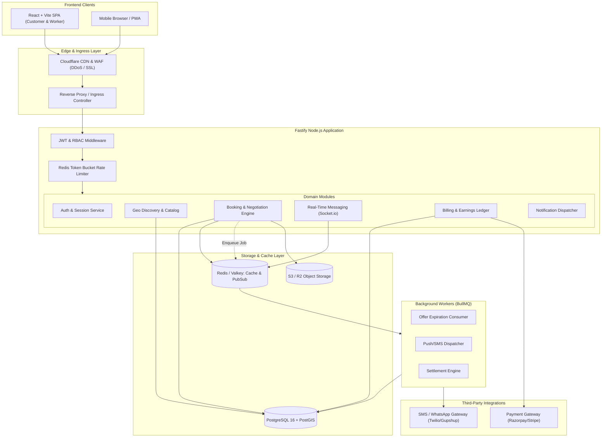

# SERVIQ — System Architecture Blueprint

**Document Version:** 1.0.0  
**Target Platform:** Hyperlocal On-Demand Blue-Collar Services Marketplace  
**Frontend Client:** React 18 + Vite (SPA)  
**Backend Runtime:** Node.js (v20+ LTS) with TypeScript (ESM)  

---

## 1. Architectural Principles & System Goals

The architecture of **Serviq** must balance extreme responsiveness (hyperlocal search and instant dispatch), transactional integrity (price negotiation locks and double-entry financial ledgers), and operational simplicity.

### Core Architectural Tenets
1. **Strict Separation of Concerns:** The React + Vite SPA is purely a presentation client. All business rules, validation, status transitions, pricing arithmetic, and authorization checks reside on the server.
2. **ACID Transactional Guarantees:** Price negotiation, booking acceptance, and financial ledger writes must execute in atomic database transactions with row-level locks (`SELECT FOR UPDATE`) to eliminate race conditions.
3. **Geospatial Precision:** Proximity queries must utilize indexing (PostGIS) to calculate road/great-circle distances within sub-millisecond latencies.
4. **Resilient Asynchrony:** Non-blocking operations (notifications, push delivery, audit logging, analytics, and offer expiration timers) are handled through background queues rather than blocking synchronous HTTP request threads.

---

## 2. Technology Stack Evaluation & Selection

### 2.1 Database Evaluation

| Database Candidate | Evaluation Criteria | Fit for Serviq | Verdict |
| :--- | :--- | :--- | :--- |
| **Vanilla PostgreSQL 16 + PostGIS** | Relational integrity, full ACID transactions, native spatial indexing (`ST_DWithin`, `ST_Distance`), row-level locks, zero vendor lock-in. | Ideal for complex multi-table joins (bookings, offers, users, reviews, ledger). | **[RECOMMENDED PRIMARY CORE]** |
| **Supabase PostgreSQL** | Managed Postgres with built-in Auth, Storage, and Realtime Engine. Excellent for accelerated MVP delivery. | High synergy with React client; provides managed Postgres, Auth, S3 storage, and WebSockets out of the box. | **[STRONGLY RECOMMENDED FOR RAPID PRODUCTION LAUNCH]** |
| **MongoDB (NoSQL)** | Schema flexibility, document store. Weak multi-document transaction guarantees; complex to maintain strict financial ledgers. | Poor fit for financial ledgers, strict relational negotiation, and complex status constraints. | **REJECTED** |
| **DynamoDB** | Extreme key-value scale. Lacks rich geospatial querying and relational querying needed for multi-filter worker discovery. | Over-engineered and rigid for complex multi-attribute marketplace filters. | **REJECTED** |

**Recommendation:** **PostgreSQL 16 with PostGIS** (hosted via Supabase or self-managed on AWS RDS).  
*Rationale:* Home service marketplaces are inherently relational (Users -> Profiles -> Addresses -> Bookings -> Offers -> Payments -> Reviews). PostGIS provides industry-standard spatial indexes (`GIST`) for radius matching.

### 2.2 Backend Framework Evaluation

| Framework | Performance | Developer Experience | Ecosystem & Stability | Verdict |
| :--- | :--- | :--- | :--- | :--- |
| **Fastify (TypeScript)** | Extremely fast (JSON schema compilation via `fast-json-stringify`), low overhead, built-in schema validation. | First-class TypeScript support, robust plugin architecture (`@fastify/sensible`, `@fastify/jwt`). | Mature, highly active. | **[RECOMMENDED]** |
| **Express.js (TypeScript)** | Moderate performance, familiar to most developers. | Requires custom boilerplate for async error handling and typing. | Legacy standard; larger memory footprint than Fastify. | Acceptable Alternative |
| **NestJS** | High structure, heavy enterprise abstraction (Angular-style decorators). | Steep learning curve, excessive ceremony for an on-demand marketplace MVP. | Mature enterprise framework. | Over-engineered for current scope |

**Recommendation:** **Fastify + TypeScript**. It provides native schema validation (via Zod or TypeBox) and high throughput for concurrent WebSocket and API loads.

### 2.3 ORM & Query Layer Evaluation
- **Prisma vs Drizzle ORM:**
  - **Drizzle ORM [RECOMMENDED]:** Zero-overhead SQL-like syntax, native TypeScript type inference, instant cold starts, native PostGIS extension support, and granular control over raw SQL transactions and locks (`for: 'update'`).
  - *Prisma* is acceptable, but its query engine binary adds latency and has historically clunky support for advanced PostGIS geometry operations.

### 2.4 Real-Time Communication Architecture
- **Requirements:** Real-time in-app chat between customer and assigned worker, immediate push of new job broadcasts to nearby workers, live offer counter notifications, and booking status transitions.
- **Technology:**
  - **Option A (Custom Stack):** **Socket.io / Native WebSockets (`@fastify/websocket`)** backed by **Redis Pub/Sub** adapter.
  - **Option B (Managed):** **Supabase Realtime** (Postgres Changes + Broadcast Channels).
- **Recommendation:** **Socket.io with Redis Pub/Sub** (or Supabase Realtime if Supabase is selected). Socket.io provides automatic fallback to HTTP long-polling on flaky mobile cellular networks, room management (`booking:SQ-1048`), and reconnection handling.

### 2.5 Background Jobs & Queue Engine
- **Technology:** **BullMQ** running on **Redis (Dragonfly / Valkey / Upstash)**.
- **Critical Scheduled Tasks:**
  - `offer-expiry-timer`: Automatically marks worker counter-offers or broadcast requests as `EXPIRED` if unaccepted after 15 minutes.
  - `booking-auto-complete`: Automatically marks a completed job as confirmed after 24 hours of customer inactivity.
  - `payout-batch-settlement`: Periodic cron calculating net balances and initiating bank transfers.
  - `push-notification-fanout`: Asynchronous delivery of Web Push / SMS / WhatsApp alerts without blocking HTTP handlers.

### 2.6 Storage Solution
- **Technology:** **S3-Compatible Object Storage** (AWS S3, Cloudflare R2, or Supabase Storage).
- **Buckets:**
  - `public-assets`: Public read (worker avatars, category icons).
  - `booking-media`: Private read via Presigned URLs (customer issue photos, work completion proof).
  - `kyc-documents`: Highly restricted private read, encrypted at rest (worker government IDs, trade certificates).

---

## 3. High-Level System Architecture Diagram



---

## 4. Backend Project Directory Structure

```
serviq-backend/
├── src/
│   ├── app.ts                  # Fastify server bootstrap & plugin registrations
│   ├── server.ts               # Process lifecycle, graceful shutdown handlers
│   ├── config/
│   │   ├── env.ts              # Zod-validated environment variables
│   │   ├── database.ts         # PostgreSQL connection pool configuration
│   │   ├── redis.ts            # Redis client configuration
│   │   └── constants.ts        # Business constants (timeouts, fee percentages)
│   ├── common/
│   │   ├── errors/             # AppError hierarchy (BadRequest, NotFound, Unauthorized)
│   │   ├── middlewares/        # Authentication, Role Guards, Request ID injection
│   │   ├── utils/              # PostGIS helpers, currency formatters, token generators
│   │   └── types/              # Global shared types and Fastify type extensions
│   ├── modules/
│   │   ├── auth/               # Registration, Login, OTP, Refresh tokens
│   │   │   ├── auth.controller.ts
│   │   │   ├── auth.service.ts
│   │   │   ├── auth.schemas.ts
│   │   │   └── auth.routes.ts
│   │   ├── customers/          # Profiles, Saved Addresses, Shortlists
│   │   ├── workers/            # Profiles, Skills, KYC verification, Availability
│   │   ├── services/           # Category catalog, taxonomy, base price rates
│   │   ├── bookings/           # Creation, Dispatch, State Machine, Concurrency
│   │   ├── negotiations/       # Counter-offers, Stepper logic, Lock acquisition
│   │   ├── messages/           # Conversations, Chat history, WebSockets
│   │   ├── notifications/      # Inbox notifications, push templates
│   │   ├── reviews/            # Rating submissions, eligibility validation, metrics
│   │   ├── earnings/           # Worker ledger, dashboard calculations, payouts
│   │   └── admin/              # KYC approval, dispute resolution, platform stats
│   ├── jobs/                   # BullMQ worker consumers & recurring cron schedules
│   │   ├── offer-expiry.job.ts
│   │   ├── notification.job.ts
│   │   └── payout.job.ts
│   └── database/
│       ├── schema/             # Drizzle / SQL table definitions
│       ├── migrations/         # Versioned SQL migration files
│       └── seeds/              # Initial categories and demo development data
├── tests/
│   ├── unit/                   # State machine and arithmetic logic tests
│   ├── integration/            # API endpoints with test database container
│   └── concurrency/            # Multi-client race condition tests
├── docker-compose.yml          # Local Postgres (PostGIS) + Redis + MinIO
├── package.json
└── tsconfig.json
```

---

## 5. Service Boundaries & Layered Architecture

Every module enforces a strict unidirectional dependency flow:
1. **Routes (`*.routes.ts`):** Defines URL patterns, HTTP methods, Fastify hooks, and input/output JSON validation schemas.
2. **Controllers (`*.controller.ts`):** Unpacks HTTP request parameters, invokes the appropriate service method, and formats the standardized JSON response. No SQL queries or business logic in controllers.
3. **Services (`*.service.ts`):** Encapsulates core business rules, multi-step workflows, transactions, and event emissions.
4. **Repositories / Data Access (`*.repository.ts`):** Performs database queries, joins, and row-level locks via the ORM.
5. **Schemas (`*.schemas.ts`):** Strict Zod schemas validating request body, query parameters, path params, and response envelopes.

---

## 6. Error Handling & Structured Logging

### 6.1 Standard Error Format
All API errors return a uniform envelope with distinct machine-readable error codes:
```json
{
  "success": false,
  "error": {
    "code": "OFFER_ALREADY_CLAIMED",
    "message": "This job was accepted by another professional while your offer was pending.",
    "details": {
      "bookingId": "SQ-1048",
      "claimedAt": "2026-10-24T05:30:00Z"
    }
  },
  "timestamp": "2026-10-24T05:30:05Z",
  "requestId": "req-9a8123-b712-4c"
}
```

### 6.2 Structured Logging with Pino
- Fastify features built-in high-performance logging via **Pino**.
- Every incoming request receives an auto-generated or distributed `X-Request-Id`.
- Logs include: `timestamp`, `level`, `requestId`, `userId`, `method`, `url`, `responseTime`, and `statusCode`.
- Sensitive fields (passwords, OTPs, auth headers, credit card info, personal phone numbers) are redacted at the logger serializer level.
